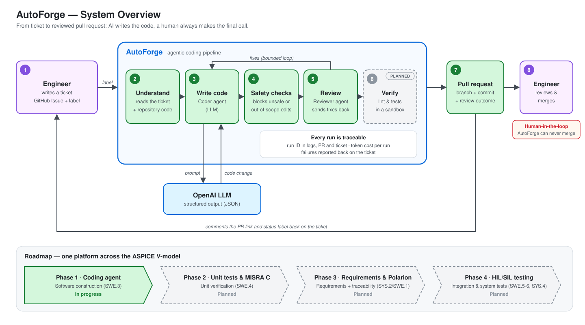
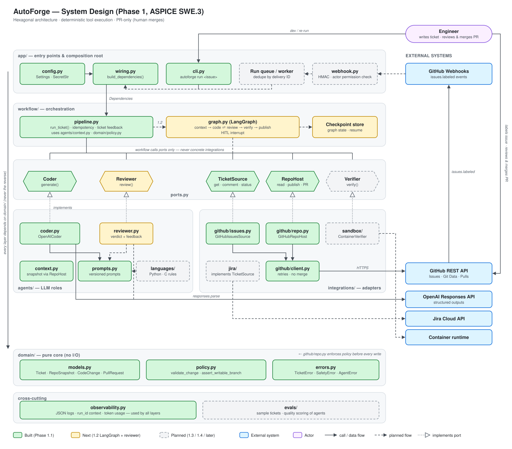
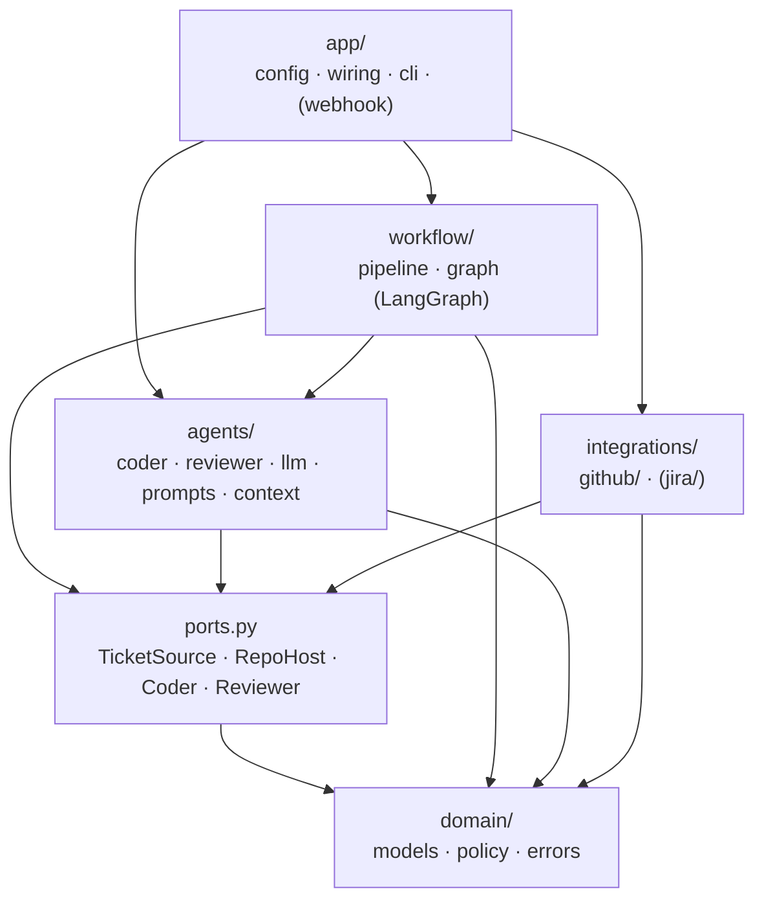
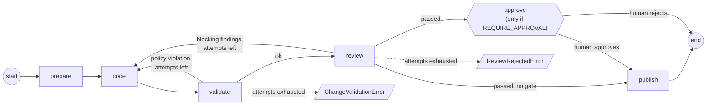
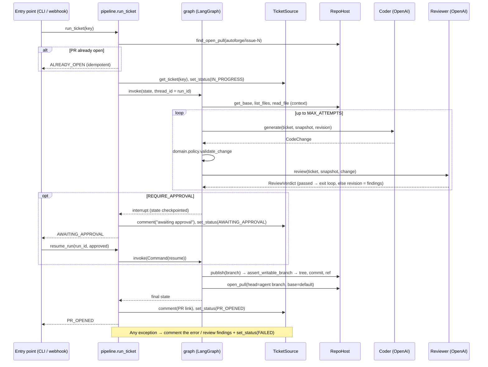

# AutoForge Architecture

This document describes the target architecture for Phase 1 (Coding Agent,
ASPICE SWE.3) and shows which parts already exist. Scope is defined in
`CLAUDE.md`, sequencing in `ROADMAP.md`.

## 1. System overview



How a ticket becomes a pull request:

1. **Engineer** writes a GitHub issue and adds the `autoforge` label.
2. **Understand:** AutoForge reads the ticket and the relevant repository code.
3. **Write code:** the coder agent sends a prompt to the OpenAI LLM and gets
   back a structured code change (JSON).
4. **Safety checks:** policy rules block unsafe or out-of-scope edits (path
   traversal, CI/CD files, files the agent never saw). Violations go back to
   the coder as feedback.
5. **Review:** a reviewer agent checks the change against the ticket's
   acceptance criteria, correctness, safety and repo conventions. Blocking
   findings go back to the coder, up to a bounded number of attempts.
6. **Verify** *(planned)*: lint and tests run in a sandbox before anything is
   published.
7. **Pull request:** AutoForge creates a branch and commit, opens a PR
   (`Closes #N`) with the review outcome, and comments the link and status back
   on the ticket. Optionally (`REQUIRE_APPROVAL=true`) the run first pauses for
   an engineer's approval.
8. **Engineer** reviews and merges. AutoForge can never merge, so a human
   always makes the final call.

GitHub is where requests come in and results go out. AutoForge has no UI. The
roadmap strip shows how the same platform extends across the ASPICE V-model in
Phases 2–4.

## 2. System design (component view)



Every block in the Phase 1 system appears here. Solid arrows are runtime calls
or data flow. Dashed arrows are planned flows. Dotted arrows with hollow heads
mean "implements this port". Colour shows status: green is built (1.1–1.2), yellow is
next (1.3, webhook service and delivery), grey is planned, blue is external,
purple is the human actor. `graph.py` is the LangGraph orchestrator;
`pipeline.py` starts or resumes it and reports every outcome on the ticket.

### Block reference

| Block | Layer | Responsibility | Status |
|---|---|---|---|
| **Engineer** | actor | Writes the ticket, labels it `autoforge`, reviews the PR and is the only one who merges | — |
| **GitHub REST API** | external | Issues, Git Data (trees, commits, refs) and Pulls endpoints | — |
| **GitHub Webhooks** | external | Pushes `issues.labeled` events to the service | — |
| **OpenAI Responses API** | external | LLM inference with schema-constrained (structured) output | — |
| **Jira Cloud API** | external | Alternative ticket source once access exists | — |
| **Container runtime** | external | Isolated workspace where repo checks run | — |
| `app/cli.py` | app | Developer entry point: `run <issue>` and `resume <run_id> [--reject]`, print a JSON result, exit code 0/1/2 | ✅ |
| `app/webhook.py` | app | HTTP endpoint. Verifies the HMAC signature and checks the labeller has write access before queueing | 🟨 1.3 |
| Run queue / worker | app | Decouples webhook response from the long agent run. Dedupes redelivered events | 🟨 1.3 |
| `app/config.py` | app | Typed settings from env / `.env`. Secrets held as `SecretStr` | ✅ |
| `app/wiring.py` | app | Composition root. The only place concrete adapters (GitHub, OpenAI agents, SQLite checkpointer) are created and injected | ✅ |
| `workflow/pipeline.py` | workflow | `run_ticket` / `resume_run`: idempotency check, load ticket, run or resume the graph, report every outcome (PR, awaiting approval, rejected, failed) on the ticket | ✅ |
| `workflow/graph.py` | workflow | LangGraph state machine: prepare → code → validate → review → (approve) → publish, with the bounded coder ↔ reviewer loop and the HITL interrupt (verify step arrives in 1.4) | ✅ |
| Checkpoint store | workflow | Graph state saved after every node, under `thread_id = run_id`. SQLite file (`CHECKPOINT_DB`); restores only allow-listed domain types | ✅ |
| `agents/context.py` | agents | Builds the `RepoSnapshot`: file tree plus selected files within a byte budget | ✅ (retrieval upgrade 1.4) |
| `agents/prompts.py` | agents | Versioned coder and reviewer system prompts and input templates. Untrusted content goes inside `<ticket>`/`<repository>`/`<proposed_change>`/`<review_feedback>` tags | ✅ |
| `agents/llm.py` | agents | Shared OpenAI structured-output call. Truncated or refused output becomes an `AgentError` | ✅ |
| `agents/coder.py` | agents | `OpenAICoder`: ticket + snapshot (+ revision feedback) → `CodeChange` | ✅ |
| `agents/reviewer.py` | agents | `OpenAIReviewer`: ticket + snapshot + change → `ReviewVerdict` with blocker / major / minor findings | ✅ |
| `agents/languages/` | agents | Per-language guidance and checks (Python, C) behind one small interface | ⬜ 1.4 |
| `TicketSource` | port | `get_ticket`, `comment`, `set_status` | ✅ |
| `RepoHost` | port | `get_base`, `list_files`, `read_file`, `find_open_pull`, `publish`, `open_pull`. No merge | ✅ |
| `Coder` | port | `generate(ticket, snapshot, revision=None) → CoderResult` | ✅ |
| `Reviewer` | port | `review(ticket, snapshot, change) → ReviewerResult` | ✅ |
| `Verifier` | port | `verify(snapshot, change) → CheckReport` | ⬜ 1.4 |
| `domain/models.py` | domain | Pure data types shared by every layer. `CodeChange` and `ReviewVerdict` double as the LLM output schemas; `Revision` carries feedback to the coder | ✅ |
| `domain/policy.py` | domain | Hard constraints in code: path rules, forbidden dirs, modify-only-what-was-seen, agent-branch-only writes | ✅ |
| `domain/errors.py` | domain | Typed, reportable failure classes | ✅ |
| `github/client.py` | integrations | REST transport: auth header, timeouts, retries that never create anything twice. Has no merge or approve method | ✅ |
| `github/issues.py` | integrations | GitHub Issues as `TicketSource`. Status shown as `autoforge:*` labels | ✅ |
| `github/repo.py` | integrations | GitHub repo as `RepoHost`. Atomic multi-file commit via the Git Data API, then opens the PR | ✅ |
| `jira/` | integrations | Jira as `TicketSource`, using workflow transitions instead of labels | ⬜ later |
| `sandbox/` | integrations | `ContainerVerifier`: runs formatter, linter and tests in a container before publishing | ⬜ 1.4 |
| `observability.py` | cross-cutting | JSON-lines logs. A `run_id` ties together the logs, PR footer and issue comment. Token usage recorded per run | ✅ |
| `evals/` | cross-cutting | Fixed sample-ticket suite that scores output quality across prompt or model changes | ⬜ 1.4 |

## 3. Layers and the dependency rule



Dependencies only point downward, and `domain/` imports nothing else in the
package. `tests/test_architecture.py` enforces these rules, so a violating
import fails CI.

| Layer | Responsibility | May import | Must not import |
|---|---|---|---|
| `domain/` | Pure models (`Ticket`, `CodeChange`, `RepoSnapshot`, …), change policy and safety rules, error types | stdlib, pydantic | everything else |
| `ports.py` | `Protocol` interfaces the core depends on | `domain` | agents, workflow, integrations, app, SDKs |
| `agents/` | LLM roles: prompts, context building, and calls to the OpenAI model | `domain`, `ports`, `openai` | workflow, integrations, app, `langgraph` |
| `workflow/` | Orchestrates one ticket run as a LangGraph graph, owns run IDs, checkpoints and idempotency, reports outcomes | `domain`, `ports`, `agents.context`, `langgraph` | integrations, app, `agents.coder` / `reviewer` / `llm`, `openai`, `httpx` |
| `integrations/` | Adapters to external systems that implement the ports | `domain`, `ports`, `httpx` | workflow, app, agents, `openai`, `langgraph` |
| `app/` | Composition root: settings, wiring, entry points | everything | — |
| `observability.py` | JSON logging and the run-ID context, used by every layer | stdlib | — |

**Why ports?** The workflow never sees `GitHubClient`, `OpenAI` or the SQLite checkpointer. Adding Jira
means adding one `TicketSource` implementation. Supporting another git host
means adding one `RepoHost`. Tests run the real workflow against fakes, with no
network access.

## 4. Package layout

```
src/autoforge/
├── domain/
│   ├── models.py          Ticket, TicketStatus, BaseRef, RepoFile, RepoSnapshot, PullRequest,
│   │                      FileChange, CodeChange, ReviewFinding, ReviewVerdict (LLM schemas),
│   │                      TokenUsage, CoderResult, ReviewerResult, Revision
│   ├── policy.py          validate_change, assert_writable_branch   ← hard constraints in code
│   └── errors.py          TicketError, ChangeValidationError, SafetyError, AgentError, ReviewRejectedError
├── ports.py               TicketSource, RepoHost, Coder, Reviewer
├── agents/
│   ├── context.py         build_snapshot / select_context_files (repo context within a budget)
│   ├── prompts.py         coder + reviewer system prompts and input templates (versioned, evaluable)
│   ├── llm.py             structured_call: one OpenAI Responses API call with error handling
│   ├── coder.py           OpenAICoder    → CodeChange
│   └── reviewer.py        OpenAIReviewer → ReviewVerdict
├── workflow/
│   ├── graph.py           LangGraph graph: prepare → code → validate → review → (approve) → publish
│   └── pipeline.py        run_ticket / resume_run(…, Dependencies, WorkflowConfig) → RunResult
├── integrations/
│   └── github/
│       ├── client.py      REST client: auth, retries, timeouts (no merge capability)
│       ├── issues.py      GitHubIssuesSource  (TicketSource)
│       └── repo.py        GitHubRepoHost      (RepoHost: Git Data API commits, PRs)
├── app/
│   ├── config.py          Settings (pydantic-settings, env / .env)
│   ├── wiring.py          build_dependencies(settings): the only place concrete classes meet
│   └── cli.py             `autoforge run <issue>` · `autoforge resume <run_id> [--reject]`
└── observability.py       JSON logs + run_id context
```

## 5. Runtime flow (one ticket run)

The agent graph (`workflow/graph.py`). Every node returns the name of the next
node; the state is checkpointed after each one.



The whole run, including ticket feedback (`workflow/pipeline.py`):



## 6. Cross-cutting concerns

| Concern | How it's handled |
|---|---|
| **Human in the loop** | `RepoHost` has no merge or approve method. `assert_writable_branch` allows writes only to `autoforge/*` branches. `tests/test_github_client.py` asserts the client has no merge method. |
| **Untrusted input** | Issue text, repo files, proposed changes and review feedback are wrapped in tags and treated as data. The coder prompt tells the model to flag injected instructions, not follow them; the reviewer treats any attempt to steer its verdict as a blocker. `domain.policy` rejects path traversal and writes under `.git/` or `.github/workflows/` whatever the models say. The reviewer's `approved` flag is not trusted alone: any blocker or major finding blocks publishing. |
| **Idempotency** | Each ticket gets a fixed branch, `autoforge/issue-<N>`. If a PR is already open for it, the run does nothing. A leftover branch with no open PR is reset. |
| **Reliability** | GitHub calls have timeouts and retry with backoff: reads and updates on 429/5xx, creates only on 429 or when the connection never opened, so nothing is created twice. The OpenAI SDK has its own retries. Truncated or refused model output becomes an `AgentError`. The coder ↔ reviewer loop is bounded by `MAX_ATTEMPTS`. |
| **Checkpoints** | LangGraph saves the run state after every node (SQLite, `CHECKPOINT_DB`, default `.autoforge/checkpoints.sqlite`, git-ignored because it holds ticket and repo content). The serializer restores only the allow-listed domain types in `workflow.graph.CHECKPOINT_TYPES`. A paused run resumes in a new process with the exact change that was reviewed, not a regenerated one. |
| **Observability** | JSON logs on stderr. A `run_id` ties together the logs, the checkpoint thread, the PR footer and the issue comment. Each LLM call logs its tokens; the run's total (coder + reviewer, all attempts) is logged and shown in the PR footer. |
| **Secrets** | `SecretStr` settings, loaded from env or `.env`, never logged. HTTP client logging is turned down so request URLs and headers don't appear in logs. |
| **Testability** | `FakeGitHub` (an in-memory REST fake on `httpx.MockTransport`) and the scripted `FakeCoder` / `FakeReviewer` let the real graph, pipeline and adapters run in tests with no network, including pause/resume across a real SQLite checkpoint. |

## 7. Where Phase 1 increments plug in

| Increment | Change | Location |
|---|---|---|
| 2. LangGraph + reviewer ✅ | `workflow/graph.py` runs behind `run_ticket` / `resume_run`. `agents/reviewer.py`, the `Reviewer` port and the `ReviewVerdict` model. SQLite checkpointer and HITL interrupt. | `workflow/`, `agents/`, `ports.py`, `domain/models.py` |
| 3. Webhook service | `app/webhook.py` (HTTP app) verifies the HMAC signature and checks the labeller has write access. It queues the run and reuses `app/wiring.py`. Adds Dockerfile and CI. | `app/`, repo root |
| 4. Context, C, verification, evals | Better `select_context_files`. Python and C prompts and checks behind a small `Language` interface. A `Verifier` port that runs the repo's checks in a sandbox container before publishing. `evals/` holds a sample-ticket suite. | `agents/`, `ports.py`, `integrations/sandbox/`, `evals/` |
| Later: Jira | `integrations/jira/` implementing `TicketSource`. | `integrations/` |

Steps 2–4 of the product roadmap (test generation, MISRA, Polarion, HIL/SIL) are
not part of this architecture yet and get no stubs.
