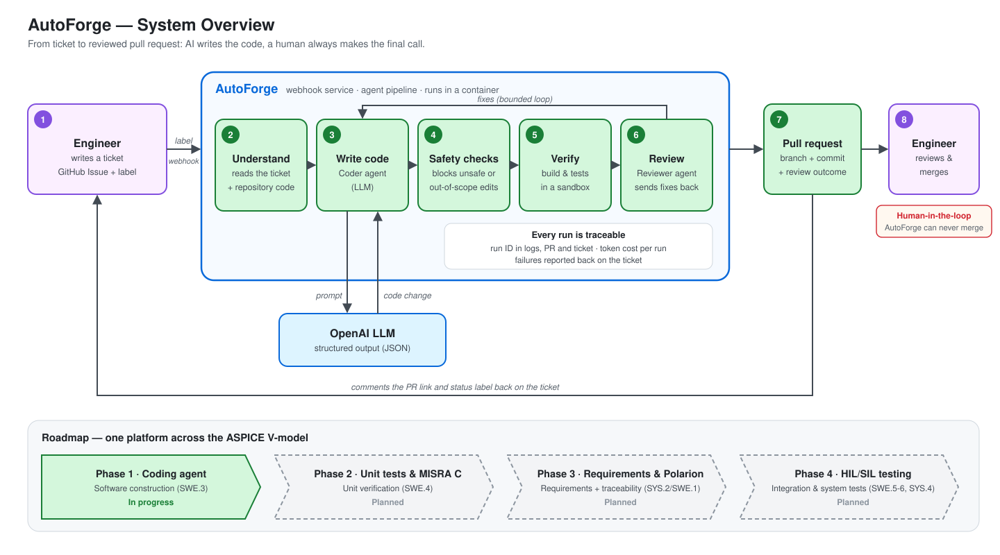
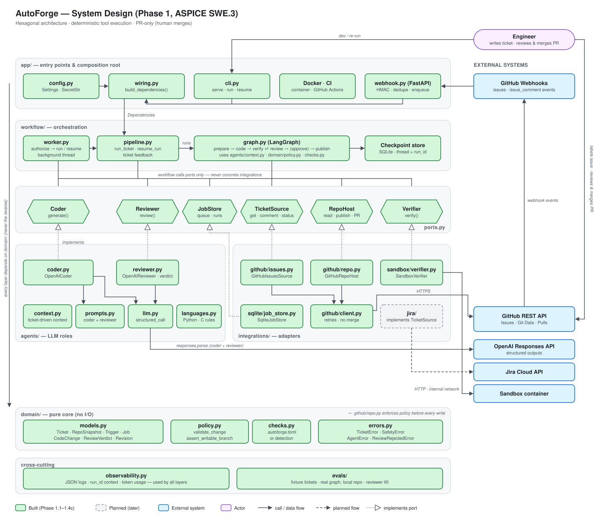
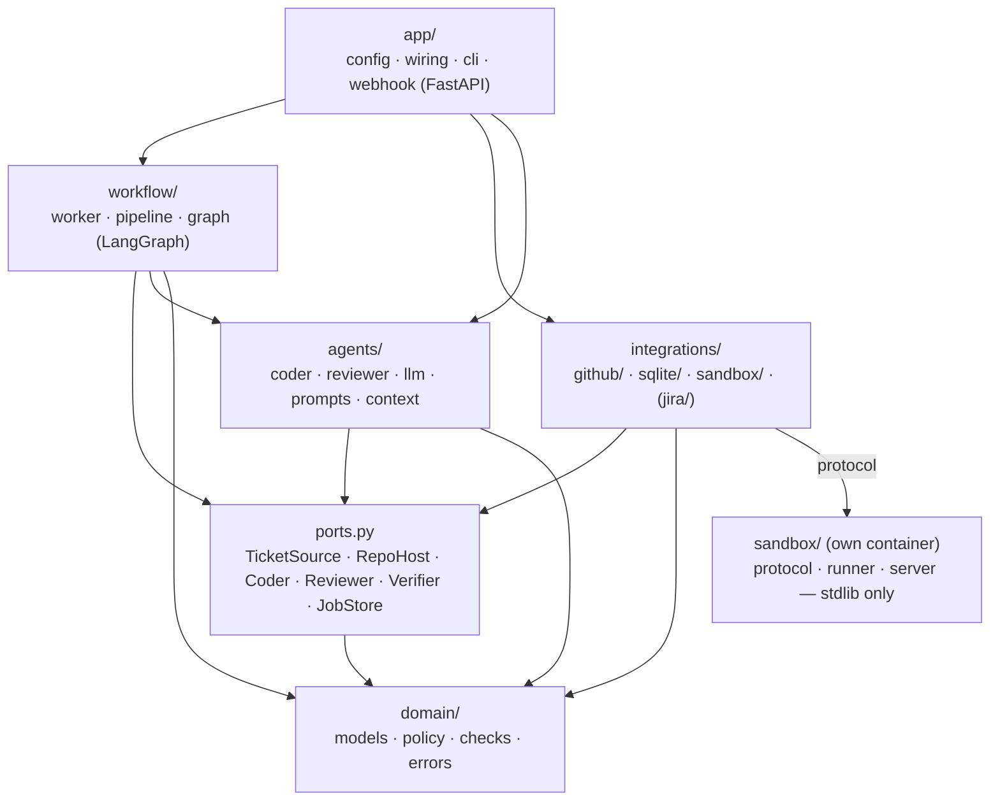
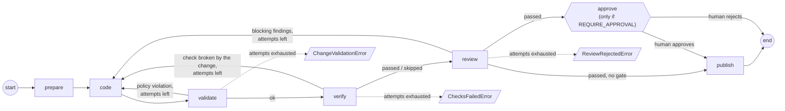
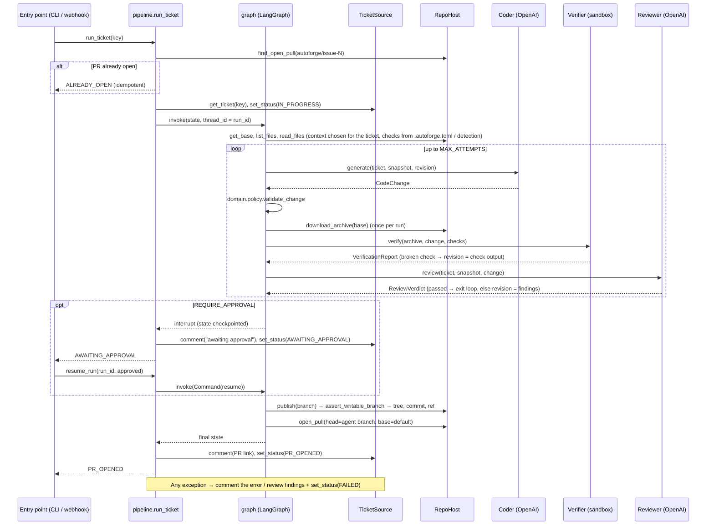

# AutoForge Architecture

This document describes the target architecture for Phase 1 (Coding Agent,
ASPICE SWE.3) and shows which parts already exist. Scope is defined in
`CLAUDE.md`, sequencing in `ROADMAP.md`.

## 1. System overview



How a ticket becomes a pull request:

1. **Engineer** writes a GitHub issue and adds the `autoforge` label. GitHub
   sends a signed webhook. The service verifies it, queues a job, and checks
   that the engineer has write access to the repo.
2. **Understand:** AutoForge reads the ticket and the relevant repository code.
3. **Write code:** the coder agent sends a prompt to the OpenAI LLM and gets
   back a structured code change (JSON).
4. **Safety checks:** policy rules block unsafe or out-of-scope edits (path
   traversal, CI/CD files, the check configuration, files the agent never saw).
   Violations go back to the coder as feedback.
5. **Verify:** the repository's own checks (CMake build + CTest, pytest, ruff,
   or what `.autoforge.toml` lists) run on the change in a separate sandbox
   container without internet access. Checks the change broke go back to the
   coder with their output; failures that already exist on the base commit do
   not count.
6. **Review:** a reviewer agent checks the change against the ticket's
   acceptance criteria, correctness, safety and repo conventions. Blocking
   findings go back to the coder, up to a bounded number of attempts.
7. **Pull request:** AutoForge creates a branch and commit, opens a PR
   (`Closes #N`) with the review outcome, and comments the link and status back
   on the ticket. Optionally (`REQUIRE_APPROVAL=true`) the run first pauses for
   an engineer's approval.
8. **Engineer** reviews and merges. AutoForge can never merge, so a human
   always makes the final call.

GitHub is where requests come in and results go out. AutoForge has no UI. The
roadmap strip shows how the same platform extends across the ASPICE V-model in
Phases 2–4.

## 2. System design (component view)



Every block in the Phase 1 system appears here. Solid arrows are runtime calls
or data flow. Dashed arrows are planned flows. Dotted arrows with hollow heads
mean "implements this port". Colour shows status: green is built (1.1–1.4b), yellow is
next (1.4c: evals), grey is planned later,
blue is external, purple is the human actor. `webhook.py` queues triggers;
`worker.py` turns each one into a run; `graph.py` is the LangGraph
orchestrator; `pipeline.py` starts or resumes it and reports every outcome on
the ticket.

### Block reference

| Block | Layer | Responsibility | Status |
|---|---|---|---|
| **Engineer** | actor | Writes the ticket, labels it `autoforge`, reviews the PR and is the only one who merges | — |
| **GitHub REST API** | external | Issues, Git Data (trees, commits, refs) and Pulls endpoints | — |
| **GitHub Webhooks** | external | Pushes signed `issues` (labeled) and `issue_comment` (created) events to the service | — |
| **OpenAI Responses API** | external | LLM inference with schema-constrained (structured) output | — |
| **Jira Cloud API** | external | Alternative ticket source once access exists | — |
| **Sandbox container** | delivery | Separate container (`autoforge.sandbox`, stdlib only) with gcc, CMake, pytest and ruff. Internal network only (no internet), read-only root, dropped capabilities, memory/CPU/PID limits. Runs each job as an unprivileged user in a fresh tmpfs workspace and kills everything the job started afterwards | ✅ |
| `app/cli.py` | app | `serve` (webhook service), `run <issue>` and `resume <run_id> [--reject]`. Prints a JSON result, exit code 0/1/2 | ✅ |
| `app/webhook.py` | app | FastAPI service: `POST /webhook` verifies the HMAC signature, parses and dedupes the event, queues a job and replies `202` in milliseconds; `GET /healthz`. Lifespan runs the worker | ✅ |
| Dockerfile · compose | delivery | Non-root, read-only container; state on the `/data` volume; health check | ✅ |
| CI (GitHub Actions) | delivery | ruff, mypy --strict, pytest on Python 3.11 / 3.12, Docker build smoke test | ✅ |
| `app/config.py` | app | Typed settings from env / `.env`. Secrets held as `SecretStr` | ✅ |
| `app/wiring.py` | app | Composition root. The only place concrete adapters (GitHub, OpenAI agents, SQLite checkpointer and job store) are created and injected | ✅ |
| `workflow/worker.py` | workflow | `process_job` + background `Worker` thread: authorizes the actor (write access), runs RUN jobs (skipped while a run awaits approval), resumes the paused run for APPROVE / REJECT, records every result | ✅ |
| `workflow/pipeline.py` | workflow | `run_ticket` / `resume_run`: idempotency check, load ticket, run or resume the graph, report every outcome (PR, awaiting approval, rejected, failed) on the ticket | ✅ |
| `workflow/graph.py` | workflow | LangGraph state machine: prepare → code → validate → verify → review → (approve) → publish, with the bounded feedback loop to the coder (policy, checks, review) and the HITL interrupt | ✅ |
| Checkpoint store | workflow | Graph state saved after every node, under `thread_id = run_id`. SQLite file (`CHECKPOINT_DB`); restores only allow-listed domain types | ✅ |
| `agents/context.py` | agents | Ticket-driven context retrieval: scores every file against the ticket's file names, identifiers and keywords, then expands along header/source pairs, includes/imports, tests, callers and build files. Fills the byte budget in priority order; large relevant files become read-only excerpts. Every file carries a reason that is logged and listed in the PR | ✅ |
| `agents/prompts.py` | agents | Versioned coder and reviewer system prompts and input templates. Untrusted content goes inside `<ticket>`/`<repository>`/`<proposed_change>`/`<review_feedback>` tags | ✅ |
| `agents/llm.py` | agents | Shared OpenAI structured-output call. Truncated or refused output becomes an `AgentError` | ✅ |
| `agents/coder.py` | agents | `OpenAICoder`: ticket + snapshot (+ revision feedback) → `CodeChange` | ✅ |
| `agents/reviewer.py` | agents | `OpenAIReviewer`: ticket + snapshot + change → `ReviewVerdict` with blocker / major / minor findings | ✅ |
| `agents/languages.py` | agents | `Language` interface (imports, definitions, related files, coder rules, reviewer checks) with `CLanguage` and `PythonLanguage`. Regex-based, no compiler or new dependency | ✅ |
| `TicketSource` | port | `get_ticket`, `comment`, `set_status`, `is_authorized(actor)` | ✅ |
| `RepoHost` | port | `get_base`, `list_files`, `read_files` (one tarball, unpacked in memory, for large repos), `download_archive` (for the sandbox), `find_open_pull`, `publish`, `open_pull`. No merge | ✅ |
| `Coder` | port | `generate(ticket, snapshot, revision=None) → CoderResult` | ✅ |
| `Reviewer` | port | `review(ticket, snapshot, change) → ReviewerResult` | ✅ |
| `JobStore` | port | `add`, `claim_next`, `finish`, `has_pending`, `last_run`, `requeue_running` | ✅ |
| `Verifier` | port | `verify(archive, change, checks) → VerificationReport`; failing checks are re-run on the base to mark them `preexisting` | ✅ |
| `domain/models.py` | domain | Pure data types shared by every layer. `CodeChange` and `ReviewVerdict` double as the LLM output schemas; `Revision` carries feedback to the coder; `Trigger` / `Job` describe queued requests | ✅ |
| `domain/policy.py` | domain | Hard constraints in code: path rules, forbidden dirs and files (`.autoforge.toml`), modify-only-what-was-seen, agent-branch-only writes | ✅ |
| `domain/checks.py` | domain | Which checks verify a change: `.autoforge.toml` from the default branch, else detected (top-level CMake projects, pytest, ruff) | ✅ |
| `domain/errors.py` | domain | Typed, reportable failure classes | ✅ |
| `github/client.py` | integrations | REST transport: auth header, timeouts, retries that never create anything twice. Has no merge or approve method | ✅ |
| `github/issues.py` | integrations | GitHub Issues as `TicketSource`. Status shown as `autoforge:*` labels | ✅ |
| `github/repo.py` | integrations | GitHub repo as `RepoHost`. Atomic multi-file commit via the Git Data API, then opens the PR | ✅ |
| `github/webhooks.py` | integrations | `verify_signature` (constant-time HMAC-SHA256) and `parse_trigger` (label → RUN, `/autoforge approve` / `reject` comment → APPROVE / REJECT) | ✅ |
| `sqlite/job_store.py` | integrations | `SqliteJobStore`: durable queue, unique delivery IDs, run history used to find paused runs | ✅ |
| `jira/` | integrations | Jira as `TicketSource`, using workflow transitions instead of labels | ⬜ later |
| `sandbox/verifier.py` | integrations | `SandboxVerifier`: sends the base archive, changed files and checks to the sandbox over HTTP; retries only failed connections, so a job is never sent twice | ✅ |
| `sandbox/` (package) | sandbox | Runs inside the sandbox container: `protocol` (wire format), `runner` (unpack, apply, run checks with timeouts and output tails, re-run failures on the base), `server` (HTTP, one job at a time as the job user, cleanup) | ✅ |
| `observability.py` | cross-cutting | JSON-lines logs. A `run_id` ties together the logs, PR footer and issue comment. Token usage recorded per run | ✅ |
| `evals/` | cross-cutting | Fixed sample-ticket suite that scores output quality across prompt or model changes | 🟨 1.4c |

## 3. Layers and the dependency rule



Dependencies only point downward, and `domain/` imports nothing else in the
package. "Web" means `fastapi` / `starlette` / `uvicorn` (allowed only in
`app/`); "storage" means `sqlite3` and the LangGraph SQLite saver (allowed in
`integrations/` and `app/`). `tests/test_architecture.py` enforces these rules,
so a violating import fails CI.

| Layer | Responsibility | May import | Must not import |
|---|---|---|---|
| `domain/` | Pure models (`Ticket`, `CodeChange`, `RepoSnapshot`, …), change policy and safety rules, error types | stdlib, pydantic | everything else |
| `ports.py` | `Protocol` interfaces the core depends on | `domain` | agents, workflow, integrations, app, SDKs, web, storage |
| `agents/` | LLM roles: prompts, context building, and calls to the OpenAI model | `domain`, `ports`, `openai` | workflow, integrations, app, `langgraph`, web, storage |
| `workflow/` | Processes queued jobs, orchestrates one ticket run as a LangGraph graph, owns run IDs, checkpoints and idempotency, reports outcomes | `domain`, `ports`, `agents.context`, `langgraph` | integrations, app, `agents.coder` / `reviewer` / `llm`, `openai`, `httpx`, web, storage |
| `integrations/` | Adapters to external systems that implement the ports | `domain`, `ports`, `httpx`, `sqlite3` | workflow, app, agents, `openai`, `langgraph`, web |
| `app/` | Composition root: settings, wiring, entry points (CLI, FastAPI service) | everything | — |
| `sandbox/` | Runs in the sandbox container: executes repository checks | stdlib only | every other layer, every third-party package |
| `observability.py` | JSON logging and the run-ID context, used by every layer | stdlib | — |

**Why ports?** The workflow never sees `GitHubClient`, `OpenAI` or the SQLite checkpointer. Adding Jira
means adding one `TicketSource` implementation. Supporting another git host
means adding one `RepoHost`. Tests run the real workflow against fakes, with no
network access.

## 4. Package layout

```
src/autoforge/
├── domain/
│   ├── models.py          Ticket, TicketStatus, BaseRef, RepoFile, ContextFile, RepoSnapshot, PullRequest,
│   │                      FileChange, CodeChange, ReviewFinding, ReviewVerdict (LLM schemas),
│   │                      TokenUsage, CoderResult, ReviewerResult, Revision, Trigger, Job,
│   │                      CheckSpec, CheckResult, VerificationReport
│   ├── policy.py          validate_change, assert_writable_branch   ← hard constraints in code
│   ├── checks.py          checks_for: .autoforge.toml or detection (CMake, pytest, ruff)
│   └── errors.py          TicketError, ChangeValidationError, SafetyError, AgentError, ReviewRejectedError,
│                          ChecksFailedError, ChecksConfigError, VerificationError
├── ports.py               TicketSource, RepoHost, Coder, Reviewer, Verifier, JobStore
├── agents/
│   ├── context.py         build_snapshot / plan_context: ticket-driven context with reasons and excerpts
│   ├── languages.py       Language interface + CLanguage / PythonLanguage (includes, definitions, rules)
│   ├── prompts.py         coder + reviewer system prompts and input templates (versioned, evaluable)
│   ├── llm.py             structured_call: one OpenAI Responses API call with error handling
│   ├── coder.py           OpenAICoder    → CodeChange
│   └── reviewer.py        OpenAIReviewer → ReviewVerdict
├── workflow/
│   ├── worker.py          process_job + Worker thread: authorize → run / resume → record
│   ├── graph.py           LangGraph graph: prepare → code → validate → verify → review → (approve) → publish
│   └── pipeline.py        run_ticket / resume_run(…, Dependencies, WorkflowConfig) → RunResult
├── integrations/
│   ├── github/
│   │   ├── client.py      REST client: auth, retries, timeouts (no merge capability)
│   │   ├── issues.py      GitHubIssuesSource  (TicketSource; write-access check)
│   │   ├── repo.py        GitHubRepoHost      (RepoHost: Git Data API commits, PRs)
│   │   └── webhooks.py    verify_signature, parse_trigger
│   ├── sqlite/
│   │   └── job_store.py   SqliteJobStore      (JobStore: durable queue + run history)
│   └── sandbox/
│       └── verifier.py    SandboxVerifier     (Verifier: HTTP client of the sandbox container)
├── sandbox/               runs in the sandbox container (stdlib only)
│   ├── protocol.py        request / response format
│   ├── runner.py          one job: unpack, apply change, run checks, re-run failures on the base
│   └── server.py          HTTP server: one job at a time as the job user, then kill + wipe
├── app/
│   ├── config.py          Settings (pydantic-settings, env / .env)
│   ├── wiring.py          build_dependencies / build_job_store: the only place concrete classes meet
│   ├── webhook.py         FastAPI app: POST /webhook, GET /healthz, worker lifespan
│   └── cli.py             `autoforge serve | run <issue> | resume <run_id> [--reject]`
└── observability.py       JSON logs + run_id context
```

Repository root: `Dockerfile`, `docker-compose.yml`, `.github/workflows/ci.yml`,
and `docs/DEPLOYMENT.md` (webhook setup and operations).

## 5. Runtime flow

### Intake: webhook → queue → worker

```mermaid
sequenceDiagram
    participant GH as GitHub
    participant S as app/webhook.py
    participant Q as JobStore (SQLite)
    participant K as workflow/worker.py
    participant T as TicketSource
    participant P as pipeline (run / resume)

    GH->>S: POST /webhook (issues.labeled or issue_comment)
    S->>S: verify HMAC signature (401 if invalid)
    S->>S: parse_trigger → RUN / APPROVE / REJECT, or ignore
    S->>Q: has_pending(ticket)? add(trigger) (unique delivery ID)
    S-->>GH: 202 queued / 200 duplicate / 200 ignored
    K->>Q: claim_next()
    K->>T: is_authorized(actor)? (write access; else drop silently)
    alt RUN
        K->>Q: last_run(ticket) — paused for approval? then skip
        K->>P: run_ticket(key)
    else APPROVE / REJECT
        K->>Q: last_run(ticket) → paused run_id (confirmed by checkpoint)
        K->>P: resume_run(run_id, approved)
    end
    K->>Q: finish(job, run_id, outcome)
```

### One ticket run

The agent graph (`workflow/graph.py`). Every node returns the name of the next
node; the state is checkpointed after each one.



The whole run, including ticket feedback (`workflow/pipeline.py`):



## 6. Cross-cutting concerns

| Concern | How it's handled |
|---|---|
| **Human in the loop** | `RepoHost` has no merge or approve method. `assert_writable_branch` allows writes only to `autoforge/*` branches. `tests/test_github_client.py` asserts the client has no merge method. |
| **Untrusted input** | Issue text, repo files, proposed changes and review feedback are wrapped in tags and treated as data. Context retrieval only *matches* ticket text against the code; tag attributes are escaped; repository archives are unpacked in memory and only regular files are read. The coder prompt tells the model to flag injected instructions, not follow them; the reviewer treats any attempt to steer its verdict as a blocker. `domain.policy` rejects path traversal and writes under `.git/`, `.github/workflows/` or to `.autoforge.toml` whatever the models say. Check output fed back to the coder is wrapped in `<review_feedback>` like reviewer findings. The reviewer's `approved` flag is not trusted alone: any blocker or major finding blocks publishing. |
| **Idempotency** | Layered: a redelivered webhook (same `X-GitHub-Delivery`) is stored once; a second RUN for a ticket already queued is dropped; a RUN while the ticket's run awaits approval is skipped; each ticket gets a fixed branch, `autoforge/issue-<N>`, and if a PR is already open the run does nothing. A leftover branch with no open PR is reset. |
| **Authorization** | Webhooks must carry a valid HMAC-SHA256 signature (constant-time check); the service refuses to start without a secret. Before acting, the worker checks that the user who added the label or wrote the approval comment has write access. Anyone else is ignored without a comment, so outsiders cannot make AutoForge spam issues. Only events from the configured repo are accepted. |
| **Sandboxed execution** | Repository code (builds, tests, linters) never runs in the service container. It runs in the `sandbox` container: internal Docker network (no internet, no published port), read-only root filesystem, tmpfs workspaces, `cap_drop: ALL` plus only `SETUID`/`SETGID`/`KILL`, `no-new-privileges`, 2 GB memory, 2 CPUs, 256 PIDs, and an init process that reaps orphans. Each job runs as the unprivileged `runner` user, each check in its own process group with a timeout; afterwards every `runner` process is killed and the workspace deleted. The sandbox holds no secrets and only the standard library of the service code. Which checks run is decided from the default branch, never by the agent. |
| **Deployment** | One container: FastAPI + one worker thread, non-root, read-only root filesystem, dropped capabilities, health check. Job queue and checkpoints are SQLite files on the `/data` volume; jobs interrupted by a restart are requeued. See `docs/DEPLOYMENT.md`. |
| **Reliability** | GitHub calls have timeouts and retry with backoff: reads and updates on 429/5xx, creates only on 429 or when the connection never opened, so nothing is created twice. The OpenAI SDK has its own retries. Truncated or refused model output becomes an `AgentError`. The coder ↔ reviewer loop is bounded by `MAX_ATTEMPTS`. |
| **Checkpoints** | LangGraph saves the run state after every node (SQLite, `CHECKPOINT_DB`, default `.autoforge/checkpoints.sqlite`, git-ignored because it holds ticket and repo content). The serializer restores only the allow-listed domain types in `workflow.graph.CHECKPOINT_TYPES`. A paused run resumes in a new process with the exact change that was reviewed, not a regenerated one. |
| **Observability** | JSON logs on stderr. A `run_id` ties together the logs, the checkpoint thread, the PR footer and the issue comment. Each LLM call logs its tokens; the run's total (coder + reviewer, all attempts) is logged and shown in the PR footer. |
| **Secrets** | `SecretStr` settings, loaded from env or `.env`, never logged. HTTP client logging is turned down so request URLs and headers don't appear in logs. |
| **Testability** | `FakeGitHub` (an in-memory REST fake on `httpx.MockTransport`) and the scripted `FakeCoder` / `FakeReviewer` let the real graph, pipeline, worker and adapters run in tests with no network, including pause/resume across a real SQLite checkpoint. The HTTP service is tested through FastAPI's test client. CI runs ruff, mypy --strict and pytest. An opt-in, read-only integration test hits the real repo. |

## 7. Where Phase 1 increments plug in

| Increment | Change | Location |
|---|---|---|
| 2. LangGraph + reviewer ✅ | `workflow/graph.py` runs behind `run_ticket` / `resume_run`. `agents/reviewer.py`, the `Reviewer` port and the `ReviewVerdict` model. SQLite checkpointer and HITL interrupt. | `workflow/`, `agents/`, `ports.py`, `domain/models.py` |
| 3. Webhook service ✅ | `app/webhook.py` (FastAPI) verifies and queues; `workflow/worker.py` authorizes and runs; `SqliteJobStore` behind the `JobStore` port; approval by issue comment; Dockerfile, compose and CI. | `app/`, `workflow/`, `integrations/`, repo root |
| 4a. Context + C ✅ | Ticket-driven `plan_context` (scoring, structural expansion, excerpts, reasons in logs and PR). `agents/languages.py` with C and Python rules for both agents. `RepoHost.read_files` with an in-memory tarball for large repos. | `agents/`, `ports.py`, `integrations/github/` |
| 4b. Verification ✅ | `Verifier` port and `verify` node: the repo's checks (`domain/checks.py`) run in the separate `sandbox` container before review; checks the change broke go back to the coder, pre-existing failures are flagged but not blamed; results in the PR. | `domain/`, `ports.py`, `sandbox/`, `integrations/sandbox/`, `workflow/graph.py`, compose |
| 4c. Evals | `evals/` holds a sample-ticket suite measuring context recall and change quality (e.g. single agent vs coder + reviewer). | `evals/` |
| Later: Jira | `integrations/jira/` implementing `TicketSource`. | `integrations/` |

Steps 2–4 of the product roadmap (test generation, MISRA, Polarion, HIL/SIL) are
not part of this architecture yet and get no stubs.
