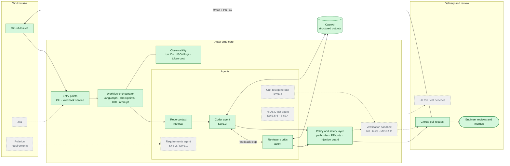

# AutoForge

**An agentic AI platform for automating the automotive software V-model,
grounded in Automotive SPICE (ASPICE).**

Automotive embedded software is built under strict process frameworks.
ASPICE requires every step, from requirements through design, code and test,
to be carried out, reviewed and traceable. AutoForge automates these
engineering activities with LLM-based agents, one V-model stage at a time. It
connects to the tools teams already use: ticketing, GitHub, requirements
management and test benches. A human engineer stays in control at every
decision point.

It starts with **Software Construction (ASPICE SWE.3)**: a coding agent that
turns a ticket into a reviewed pull request.

```
  Requirements ──────────────────────────────────────────▶ System verification
   (Phase 3)  ╲                                         ╱   (Phase 4, SYS.4)
               ╲  Architecture / design          Integration & HIL/SIL ╱
                ╲                                  (Phase 4)          ╱
                 ╲  Detailed design + code  ◀──▶  Unit verification  ╱
                  ╲  (Phase 1, SWE.3)              (Phase 2, SWE.4) ╱
                   ╲──────────────────────────────────────────────╱
```

## Roadmap

| Phase | V-model stage (ASPICE) | What AutoForge automates | Status |
|---|---|---|---|
| **1 · Coding Agent** | Software construction (SWE.3) | Ticket → multi-agent code generation (coder + reviewer) → pre-PR verification → pull request → status reported back on the ticket. Python and C. | 🟡 In progress |
| **2 · Unit Testing & Static Analysis** | Unit verification (SWE.4) | Automated unit-test generation for produced code. Static analysis and coding-standard enforcement, including **MISRA C** compliance checks. | ⚪ Planned |
| **3 · Requirements Engineering** | Requirements analysis (SYS.2 / SWE.1) | Requirements authoring and quality checks. **Polarion** integration. End-to-end traceability from requirement to design, code and test. | ⚪ Planned |
| **4 · HIL/SIL Test Automation** | Integration & system verification (SWE.5–6, SYS.4) | Hardware-in-the-Loop and Software-in-the-Loop test generation and execution, moving toward system-level verification. | ⚪ Planned |

### Phase 1 in detail

| Increment | Scope | Status |
|---|---|---|
| 1. Core pipeline | GitHub issue → OpenAI coder agent (structured outputs) → validated change → branch + commit → PR → issue comment/labels | ✅ Built |
| 2. Multi-agent orchestration | **LangGraph** graph: coder ↔ reviewer/critic loop (bounded attempts, policy violations fed back to the coder), SQLite checkpoints, optional human-approval interrupt | ✅ Built |
| 3. Service & delivery | **FastAPI** webhook service (HMAC-verified, write-access check), durable SQLite job queue + background worker, idempotent runs (redelivery and re-label dedupe), `/autoforge approve` comments, Docker image + compose, GitHub Actions CI (ruff, mypy --strict, pytest, Docker build) | ✅ Built, 115 automated tests |
| 4. Quality | Repo-context retrieval, C code generation, sandboxed pre-PR verification (lint/tests), evaluation harness measuring reviewer lift | ⚪ Next |
| Later | Jira as a second ticket source (pluggable `TicketSource` port) | ⚪ Planned |

## Architecture



<sub>🟩 built (Phase 1.1–1.3) · ⬜ planned (Phase 1.4 and Phases 2–4) · solid
arrows = working today, dashed = planned.</sub>

Layers, ports and the per-run sequence diagram are in
[ARCHITECTURE.md](ARCHITECTURE.md).

## Design principles

- **Human-in-the-loop by construction.** Agents only open pull requests. The
  code has no way to merge or approve, and writes are allowed only on
  agent-owned branches. Tests enforce both.
- **Process-grounded.** Each phase maps to an ASPICE process, and every run is
  traceable from ticket to agent run to commit to PR through a shared run ID.
- **Secure with untrusted input.** Ticket and repo content are treated as data,
  never instructions, to guard against prompt injection. A policy layer rejects
  unsafe paths and any change to CI/CD or `.git/`, whatever the model outputs.
- **Pluggable integrations.** A hexagonal (ports and adapters) architecture
  keeps agents and workflow independent of GitHub, Jira, Polarion or the LLM
  provider. Layer rules are enforced by tests.
- **Deterministic tool execution.** The LLM only produces a structured change.
  Plain code performs every GitHub operation after policy checks. There is no
  autonomous tool calling, so the model cannot invoke merge or delete.
- **Production-grade.** Typed Python, structured JSON logging, retries that
  never create a PR or comment twice, idempotent ticket runs, per-run token and
  cost tracking, and fully offline tests.

## Tech stack

Python 3.11 · OpenAI Responses API (structured outputs) · LangGraph (SQLite checkpoints)
· FastAPI / uvicorn · GitHub REST API and webhooks · pydantic / pydantic-settings · httpx
· SQLite · pytest · ruff · mypy (strict) · Docker · GitHub Actions

## How it works today (Phase 1, increments 1–3)

A maintainer adds the `autoforge` label to an issue. GitHub sends a webhook to
the AutoForge service, which verifies its HMAC signature, drops duplicates,
queues a job and replies at once. A background worker checks that the person
who added the label has write access, then runs the LangGraph agent graph
(`autoforge run <issue>` runs the same steps from the CLI):

1. Reads the GitHub issue (title, body, comments, labels) and labels it
   `autoforge:in-progress`.
2. Snapshots the repo's default branch: the file tree plus convention and
   source files, up to a size budget.
3. **Coder agent** (OpenAI, structured outputs) proposes a change: files,
   commit message, PR title and body.
4. **Policy layer** validates it: paths must be safe, nothing may be written
   under `.git/` or `.github/workflows/`, and a file can only be modified if
   the agent saw its current content. A violation goes back to the coder as
   feedback.
5. **Reviewer agent** checks the change against the ticket's acceptance
   criteria, correctness, safety and repo conventions, and returns a verdict
   with findings graded blocker / major / minor. Blocking findings go back to
   the coder, up to `MAX_ATTEMPTS` (default 3). If the reviewer still rejects,
   no PR is opened and the findings are posted on the issue.
6. **Optional human approval** (`REQUIRE_APPROVAL=true`): the graph pauses and
   checkpoints its state. A maintainer comments `/autoforge approve` to
   publish the reviewed change, or `/autoforge reject` to discard it. The run
   survives a restart in between.
7. Commits to `autoforge/issue-<N>` and opens a PR against the default branch
   (`Closes #N`), including the review outcome, any non-blocking reviewer
   notes, and the run's total token usage.
8. Comments the PR link on the issue and labels it `autoforge:pr-opened`. If
   the run fails, it labels the issue `autoforge:failed` and comments why.

Duplicates are handled at every level. A webhook GitHub redelivers is processed
once. A second label on a ticket that is already queued, already has an open
AutoForge PR, or is waiting for approval starts nothing new. Every run has a run
ID, which appears in the JSON logs, the checkpoint, the PR and the issue comment.

## Setup

```bash
python -m venv .venv
.venv/Scripts/activate        # Windows; use .venv/bin/activate on Linux/macOS
pip install -e ".[dev]"
cp .env.example .env          # then fill in the values
```

The GitHub token must be a fine-grained token limited to the target repo, with
read/write on Contents, Pull requests and Issues, plus read on Metadata. The
repo needs at least one commit on its default branch.

## Usage

**As a service** (the normal way): `docker compose up -d --build`, then point a
GitHub webhook at it. Step-by-step instructions, including a local tunnel, are in
[docs/DEPLOYMENT.md](docs/DEPLOYMENT.md). After that, label an issue `autoforge`.

**From the CLI** (development and re-runs):

```bash
autoforge serve --port 8080         # the webhook service without Docker
autoforge run 12                    # or: python -m autoforge run 12
autoforge resume <run_id>           # approve a run paused for approval (REQUIRE_APPROVAL=true)
autoforge resume <run_id> --reject  # reject it; no PR is opened
```

`run` and `resume` print a JSON result line (`run_id`, `outcome`, `pr_url`, `error`)
on stdout and writes structured logs to stderr. Outcomes: `pr_opened`,
`already_open`, `awaiting_approval`, `rejected`, `skipped`, `failed`. Exit codes: 1 means
the run failed, 2 means a configuration error, 0 otherwise.

## Tests

```bash
ruff check && mypy && pytest                     # what CI runs
AUTOFORGE_INTEGRATION=1 pytest -m integration    # opt-in, read-only check against the real repo
```

The tests run against an in-memory fake GitHub API and scripted fake coder and
reviewer agents. They make no network calls. They cover the webhook service
(signatures, dedupe), the job queue and worker (authorization, approvals), and
pause/resume across real SQLite files. They also enforce the architecture's layer
rules and the PR-only safety guarantees. GitHub Actions runs lint, strict type
checks and the tests on Python 3.11 and 3.12, then builds the Docker image.
